<h1 align="center">portwatch</h1>

<p align="center">
  <b>See every network port on your Linux machine, who is using it, and stop it safely, all from one terminal dashboard.</b>
</p>

<p align="center">
  
  
  
</p>

<p align="center">
  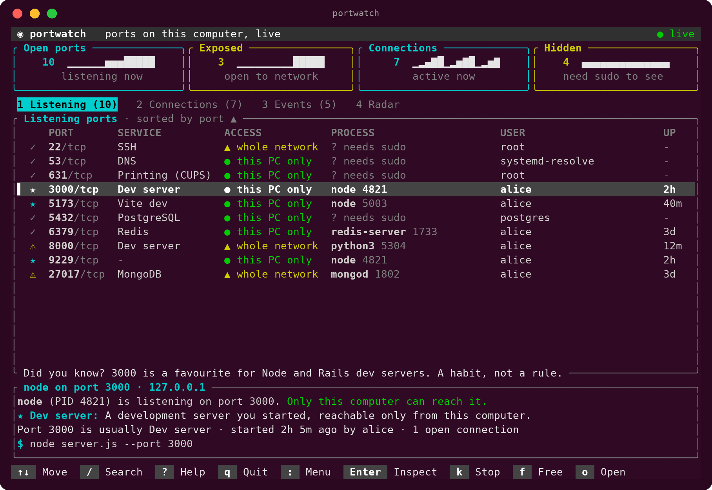
</p>

Type `portwatch` and it opens a full-screen dashboard, a bit like `htop` but for ports. Quit with `q` and you are back in your shell. It reads the kernel's own tables, so it needs no `ss`, `lsof` or root to get started.

- [What it does](#what-it-does)
- [Install](#install)
- [Quick start](#quick-start)
- [A tour of the dashboard](#a-tour-of-the-dashboard)
- [Keys](#keys)
- [The Inspector](#the-inspector-technical-detail-on-request)
- [Stopping processes safely](#stopping-processes-safely)
- [The fun parts](#the-fun-parts)
- [Settings and themes](#settings-optional)
- [Permissions and security](#permissions-and-security)
- [Troubleshooting](#troubleshooting)
- [How it works](#how-it-works)
- [Development](#development)
- [Known limits](#known-limits)
- [License](#license)

## What it does

- **Shows what is open.** Every listening port, which program owns it, who started it, how long it has been up, and whether only your computer or the whole network can reach it.
- **Explains it in plain words.** Each row gets a mark (normal, dev server, worth a look) with the reason, plus a sentence about what that port number is usually used for.
- **Lets you act.** Stop a program, or free a port and have portwatch check that it really became free. It always asks first and refuses to touch anything dangerous.
- **Goes deep when you ask.** Press `Enter` for an Inspector with process details, every socket, the systemd service or Docker container it came from, and the raw `/proc` text.
- **Is also a normal command.** `portwatch list`, `portwatch free 3000` and `portwatch inspect 3000 --json` work in scripts and pipes.
- **Has some fun in it.** A phosphor radar, history graphs, confetti when a port is freed, "Did you know?" tips and eight colour themes.

## Install

portwatch needs **Linux** and a recent **stable Rust** toolchain (the project uses Rust edition 2024).

**1. Install Rust** (skip this if `cargo --version` already works):

```bash
curl --proto '=https' --tlsv1.2 -sSf https://sh.rustup.rs | sh
```

Open a new terminal afterwards so `cargo` is on your `PATH`.

**2. Get the code and install the command:**

```bash
git clone <repository-url> portwatch
cd portwatch
cargo install --path . --locked
```

This builds a release binary and puts `portwatch` in `~/.cargo/bin`. Then run:

```bash
portwatch
```

If you see "command not found", `~/.cargo/bin` is not on your `PATH`. Add this line to `~/.bashrc` (or your shell's startup file) and open a new terminal:

```bash
. "$HOME/.cargo/env"
```

**Just trying it out?** Skip the install and run it straight from the project folder:

```bash
cargo run --release
```

### Update

Pull the latest code and reinstall over the old version:

```bash
git pull
cargo install --path . --force --locked
```

### Uninstall

```bash
cargo uninstall portwatch
rm -rf ~/.config/portwatch ~/.local/state/portwatch   # optional: settings and the "tour seen" marker
```

## Quick start

| Command | What it does |
|---|---|
| `portwatch` | Opens the dashboard |
| `portwatch list` | Prints listening ports as a table and exits (works in scripts and pipes) |
| `portwatch list --all` | Also includes every connection, with its state (one line per socket, for scripts) |
| `portwatch free <port>` | Finds what is using the port, asks, stops it, and checks that the port is really free (`--yes` skips the question, `--force` sends SIGKILL) |
| `portwatch inspect <port>` | Everything about the program using a port: process details, every socket it has, and where it comes from (systemd or Docker). Add `--json` for JSON you can pipe anywhere |
| `portwatch config` | Shows where the optional settings file goes and what it can contain |
| `portwatch --help` / `--version` | Help and version |

`portwatch free 3000` fixes the classic "address already in use" error. Unlike `fuser -k`, it asks first, tries SIGTERM before anything harsher, refuses to touch PID 1 or itself, and tells you whether the port was actually freed (exit code 0) or who still holds it (exit code 1).

To see and manage programs that belong to other users, run it with sudo (see [Permissions](#permissions-and-security)):

```bash
sudo "$(which portwatch)"
```

## A tour of the dashboard

The first time you start portwatch, a three-page tour explains what a port is and how to read a row. Press `?` for help at any time, or `:` for a command menu where you can find any action by typing its name.

<p align="center">
  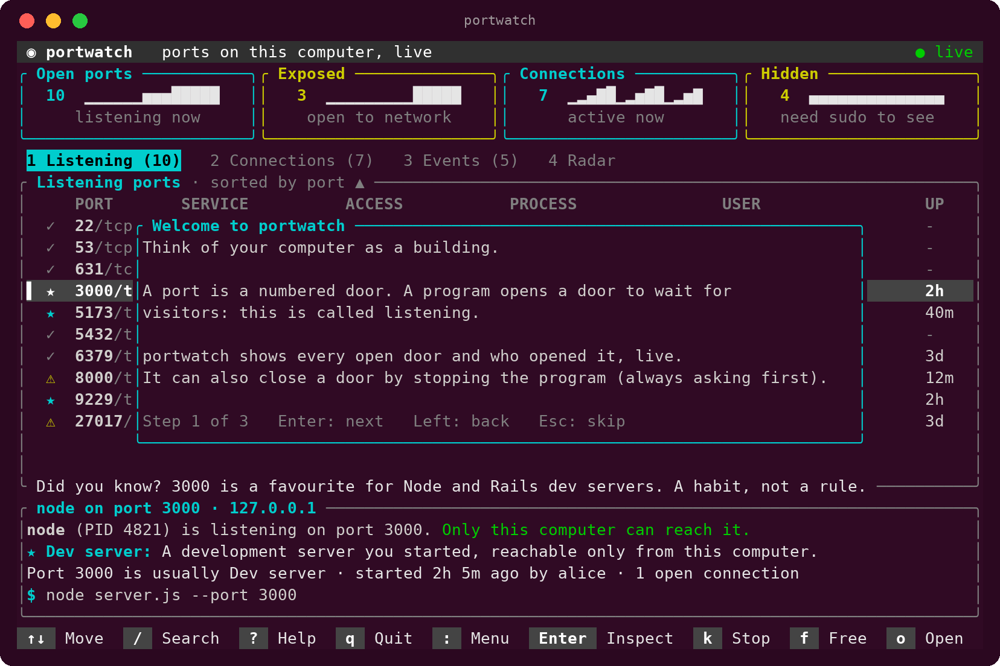
</p>

### Listening ports

The main view. There is **one row per program per port**: if a server listens on both IPv4 and IPv6 (say `127.0.0.1` and `::1`), it is one row, and its ACCESS shows the most exposed address. Programs you can see are never merged with each other (different PIDs stay separate). Hidden owners are grouped by account and port. `portwatch list` still shows every socket.

- **Summary cards** at the top: open ports, how many are exposed to the network, active connections, and how many ports have an owner you cannot see. Each card has a small history graph.
- **The mark in the first column** is a quick opinion, with the reason in the Details panel:
  - `✓` looks normal (dim)
  - `★` a development server you started
  - `⚠` worth a look, for example a database open to the network, or an open port whose program you cannot see

  These are simple rules, not a security audit. They will sometimes be wrong, which is why the reason is shown.
- **SERVICE** is what that port number is normally used for (3306 is usually MySQL, 6379 Redis, and so on). It is a guess from the number only: any program can listen on any port.
- **ACCESS** tells you who can connect:
  - `● this PC only` (green): the port is bound to loopback, so only programs on this computer can reach it.
  - `▲ whole network` (yellow): bound to every network interface, so other devices on your network can try to connect.
  - `◆ one network` (yellow): bound to one specific network address.
- **UP** is how long the program has been running.
- **Green** rows opened in the last few seconds. **Red, struck-through** rows just closed.
- The **Details** panel explains the selected port in plain sentences, then shows how long it has been running, its open connections, the full command and its folder.
- Press `t` to swap the friendly columns for the **technical table**: the exact bind addresses, kernel socket state, PID and inode (a `+2` means two more sockets are merged into the row).

<p align="center">
  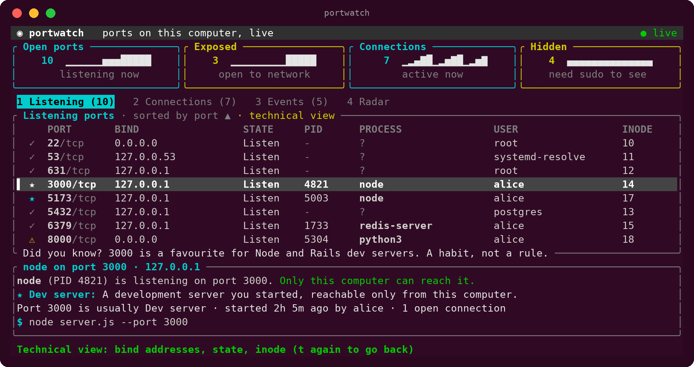
</p>

### Connections

Every active connection: local and remote address, state, and the program that owns it.

<p align="center">
  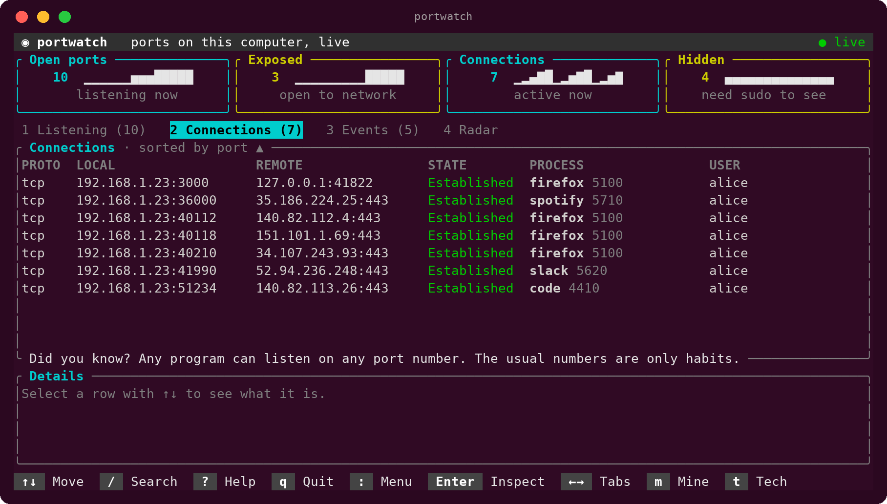
</p>

### Events

A log of every listening port that opens or closes while portwatch is running.

<p align="center">
  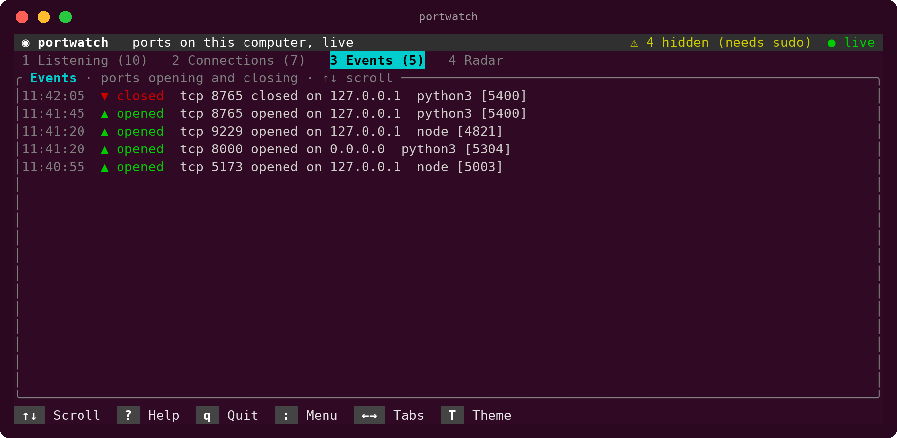
</p>

### Radar

Your listening ports as dots on three rings. See [The fun parts](#the-fun-parts).

<p align="center">
  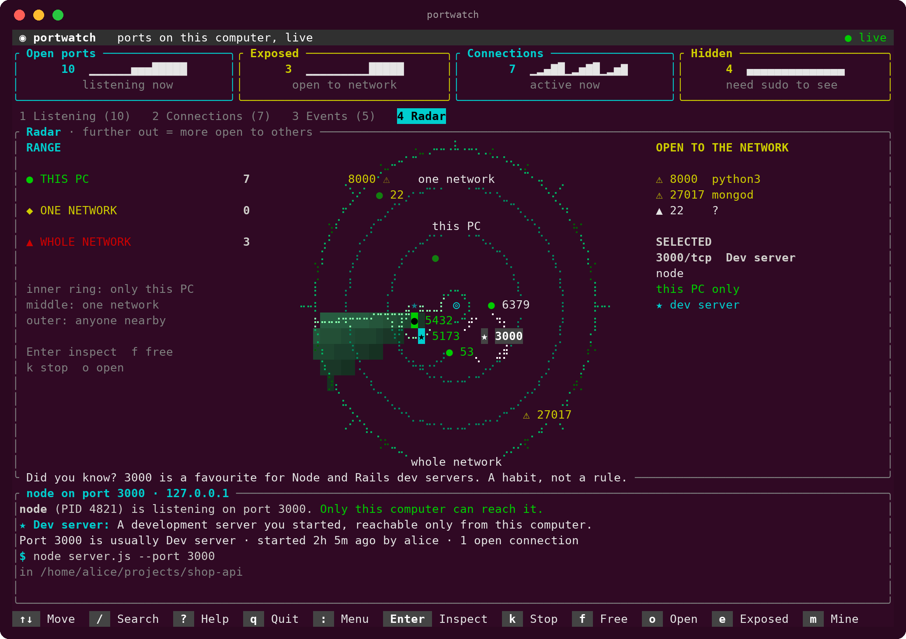
</p>

### Command menu and help

`:` (or `Ctrl+P`) opens a menu of every action. Type a few letters to filter it. `?` shows what the columns and marks mean.

<p align="center">
  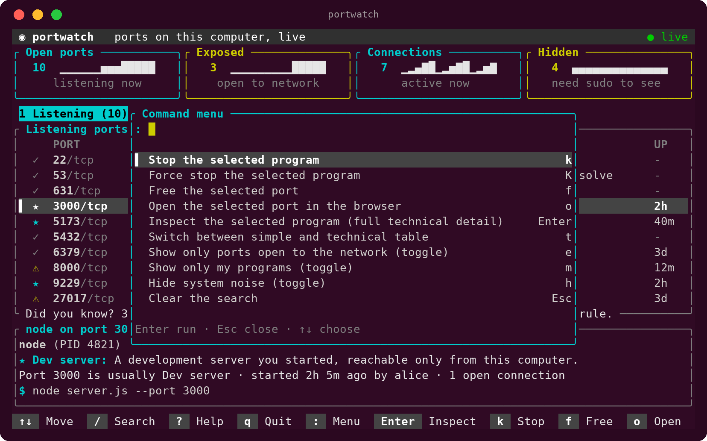
  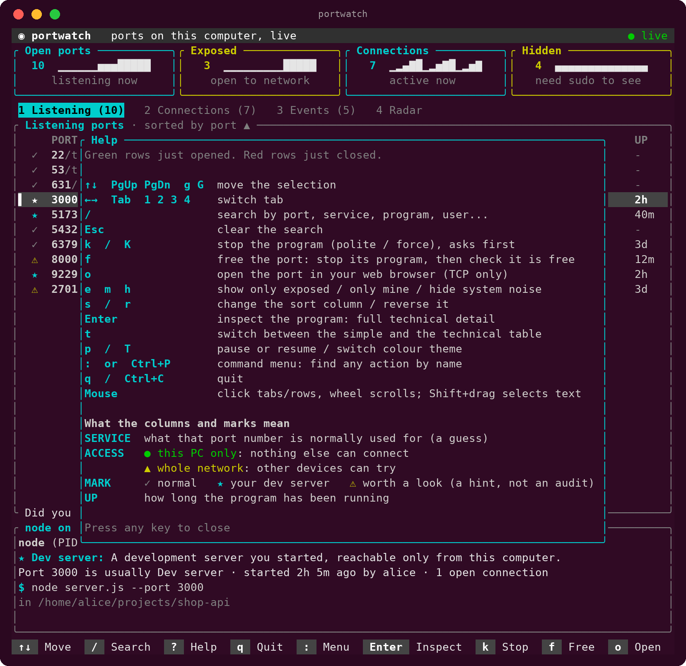
</p>

## Keys

| Key | Action |
|---|---|
| `↑` `↓` `PgUp` `PgDn` `g` `G` | Move the selection |
| `←` `→` / `Tab` / `1` `2` `3` `4` | Switch tab: Listening, Connections, Events, Radar |
| `/` | Search by port, service, program, user, address, PID (several words must all match). Try `mysql`, `network` or `this pc` |
| `Esc` | Clear the search |
| `e` / `m` / `h` | Toggle: only ports open to the network / only my programs / hide system noise (DNS, printing, discovery) |
| `s` / `r` | Change sort column (port, process, PID, user, uptime, access) / reverse the order |
| `Enter` | Open the **Inspector** (see below) |
| `t` | Switch the table between the simple view and the technical view |
| `k` / `K` | Stop the selected program (SIGTERM) / force stop (SIGKILL). Asks to confirm first |
| `f` | Free the port: stop its program, then check that the port really became free |
| `o` | Open the port in your web browser (TCP only) |
| `:` or `Ctrl+P` | Command menu |
| `p` | Pause or resume refreshing |
| `T` | Try the next colour theme (lasts until you quit; see Settings to keep one) |
| `?` | Help |
| `q` / `Ctrl+C` | Quit |

The mouse works too: click a tab or a row, scroll with the wheel. (While the mouse is captured, hold `Shift` to select text with the terminal. Turn it off with `mouse = false` in the settings file.)

The layout adapts to your terminal. On short windows the summary cards and then the details panel are hidden, and the footer drops its least important keys. It works down to 80×24.

### The Inspector (technical detail on request)

Press `Enter` on a row to open a full-screen Inspector for its program. `Esc` goes back. Switch tabs with `←` `→` or `1`-`6`, scroll with `↑` `↓` `PgUp` `PgDn` `Home` `End` or the wheel.

<p align="center">
  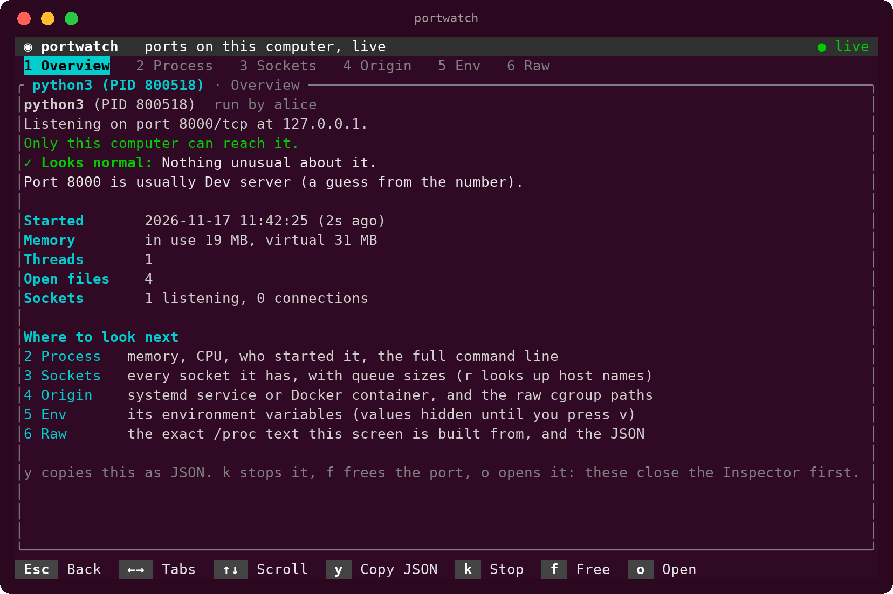
  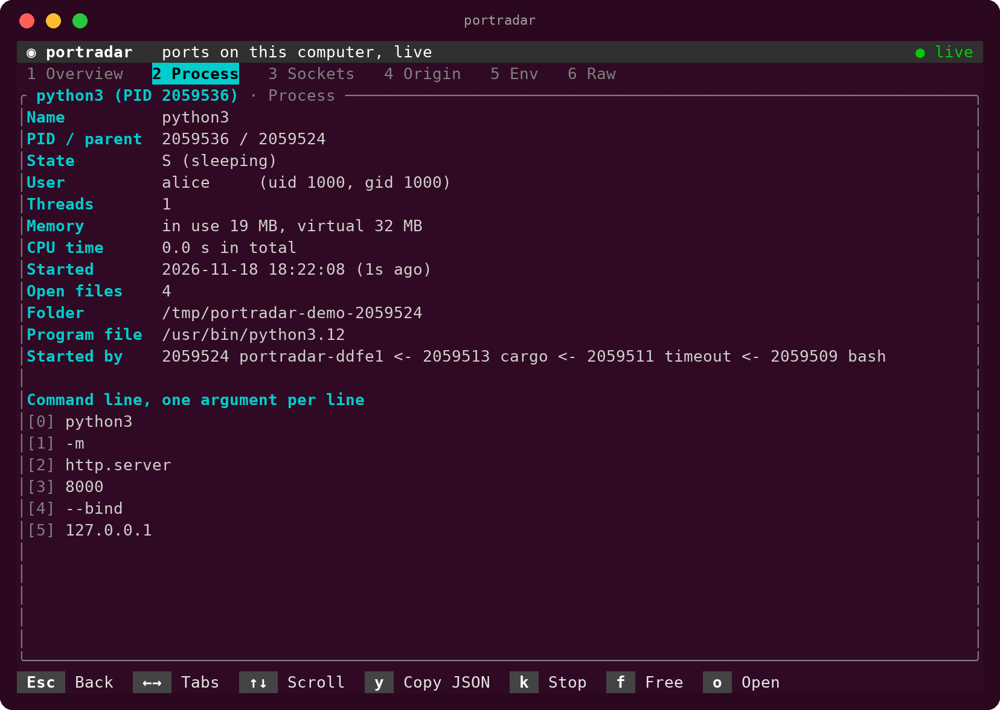
  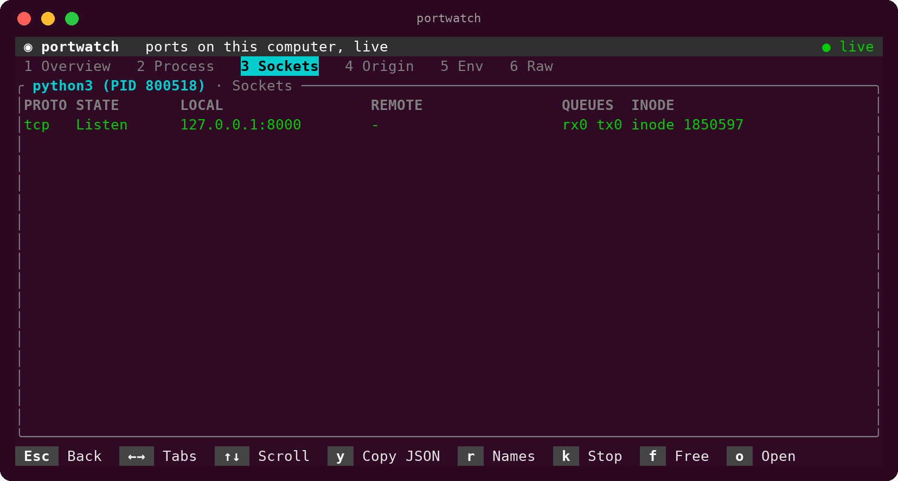
</p>

| Tab | Shows |
|---|---|
| **1 Overview** | A plain-English summary, the mark and its reason, and where to look next |
| **2 Process** | PID, parent and the chain of parents up to init, state, user/uid/gid, threads, memory, CPU time, start time, open files, folder, program file, and the command line one argument per line |
| **3 Sockets** | Every socket the program has: state, local and remote address, receive and send queue sizes, inode. Press `r` to look up host names for the remote addresses (see below) |
| **4 Origin** | The systemd service or Docker container it belongs to, and the raw cgroup paths |
| **5 Env** | Its environment variables. **Values are hidden** until you press `v`, and hidden again as soon as you change tab or close the Inspector |
| **6 Raw** | The JSON that `y` copies, then the exact `/proc` text everything above was built from, so you can check the work |

- `y` copies the JSON. It tries `wl-copy`, `xclip` and `xsel` if installed. If none is, it asks your terminal to copy (many terminals ignore that) and says so; it never claims a copy worked unless a program accepted it. Installing `wl-clipboard` (`sudo apt install wl-clipboard`) is the dependable fix on Wayland. `portwatch inspect <port> --json | wl-copy` works too.
- **Secrets:** environment variables are never part of the JSON, the Raw tab or the plain-text report. The JSON does include the program's **command line**, and command lines sometimes contain passwords, so look before you share it.
- **Host names:** `r` sends the remote addresses to your DNS resolver (reverse lookup). It only happens when you ask, loopback addresses are skipped, at most 50 are looked up, and results (including failures) are remembered.
- `k`, `f` and `o` work from the Inspector too: they close it first and then use the normal confirmation popup and safety checks.
- The Inspector refreshes with every scan. If the program exits while you are looking, its last known details stay on screen with a notice, and the actions are switched off.
- Details of other users' programs are not readable without `sudo`; the Inspector says so instead of guessing.

## Stopping processes safely

<p align="center">
  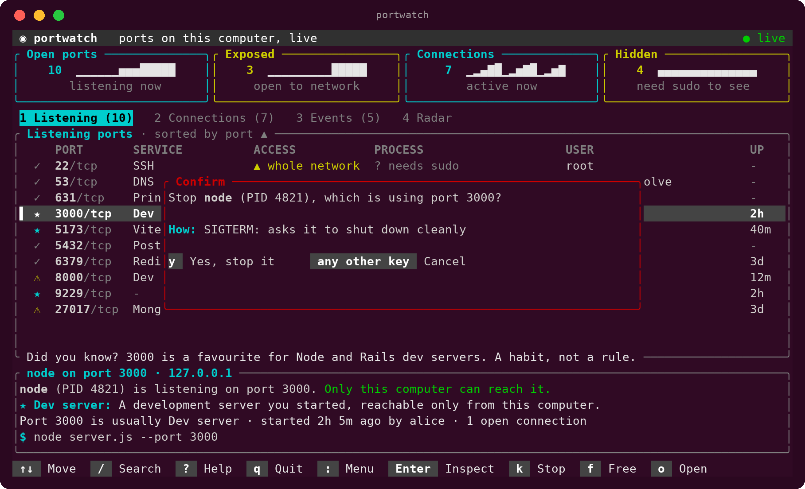
</p>

- You always confirm first, and the popup shows the process name, PID and port.
- It refuses to kill PID 1 or portwatch itself.
- Just before sending the signal it checks that the PID still belongs to the same program (PIDs get reused), so it cannot hit the wrong process.
- If the process is a **Docker container** or a **systemd service**, the popup and Details panel warn you that killing it may just restart it, and tell you the right command (`docker stop ...` or `sudo systemctl stop ...`).
- Killing only works from the Listening tab.
- `f` and `portwatch free` do not take "I sent the signal" for success: they scan again and say whether the port is free or who still holds it. Servers that run several worker processes may need `K`.
- `o` never opens a browser when portwatch runs as root.

## The fun parts

- **Radar** (`4`): your listening ports as dots on three rings, drawn as a phosphor scope with smooth Braille lines.
  - The centre is this computer. The inner ring is ports only this computer can reach, the middle ring one network, the outer ring the whole network, so the more open a port is, the further out it sits. The rings are named on the screen.
  - A bright beam sweeps round every six seconds and leaves a soft glow behind it. Dots it passes flash, send out a small ring, and fade slowly. Quiet inner ports are labelled only for a few seconds after the beam passes; ports open to a network and the selected port (marked with rotating brackets) are always labelled. A port that just opened sends out a ripple.
  - On windows about 92 columns wide or more there are two side panels: **Range** (how many ports sit in each ring, and what the rings mean) on the left, and **Open to the network** (worrying ports first) plus a **Selected** card on the right. Narrower windows get the scope alone.
  - Each dot keeps its place unless another port in the same ring needs the same spot (positions are worked out from the port and program, never from the sort order). If the rings are too full, `+N not shown` says so.
  - `↑` `↓`, the filters, `k`, `f`, `o` and `Enter` work as on the Listening tab (sorting and the technical table only apply to the table).
  - With `ascii = true` the radar is drawn with plain characters instead of Braille. With 24-bit colour (most modern terminals; portwatch checks `COLORTERM`) the sweep's glow is a smooth gradient, otherwise it uses a few 256-colour steps. `truecolor = false` turns the gradient off.
- **History graphs** on the summary cards: the last 60 refreshes of each count (a minute at the default rate), squeezed to fit the card by keeping the highest value of each group, so a short spike still shows.
- **Confetti** when you free a port with `f` and portwatch has checked that the port really is free. Plain `k` never celebrates.
- **Did you know?** A line under the table with a fact about the selected port (SSH, DNS, MySQL, Redis and so on, kept to default ports and what the protocol does), or a tip about portwatch that changes every 15 seconds.
- **Themes:** `default`, `light`, `mono`, `nord`, `dracula`, `cyberpunk`, `matrix` and `colorblind` (blue and orange instead of green and red). `T` cycles through them. They use 256-colour values, so they work on any 256-colour terminal.

<p align="center">
  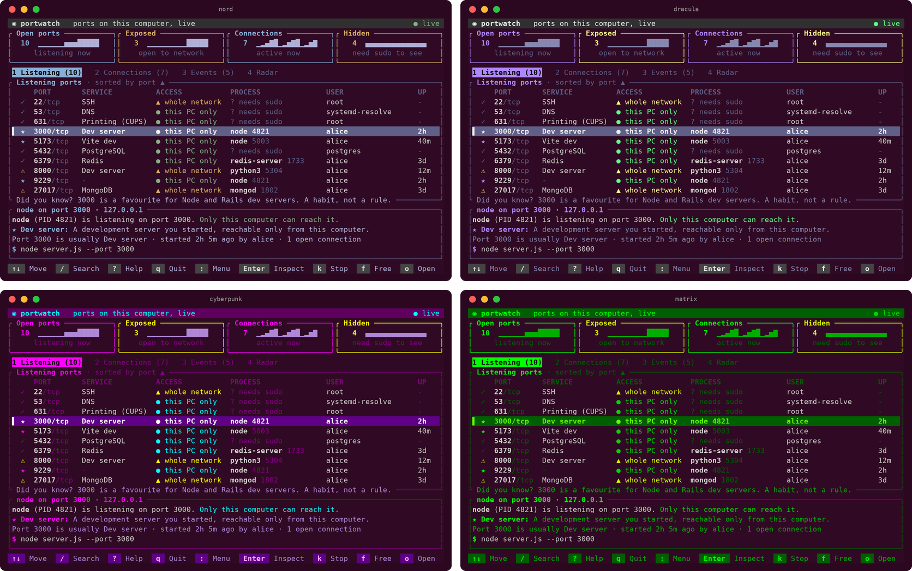
</p>

For a perfectly still screen set `animations = false` (no sweep, ripples or confetti; the radar stays put). `tips = false` hides the Did you know? line.

## Settings (optional)

portwatch works without any settings. To change them, create `~/.config/portwatch/config.toml` (run `portwatch config` to see the exact path and a template):

```toml
refresh_seconds = 1     # how often the table refreshes (1 to 30)
theme = "default"       # default, light, mono, nord, dracula, cyberpunk, matrix, colorblind
ascii = false           # true = plain ASCII symbols and borders
mouse = true            # click tabs and rows, scroll with the wheel
animations = true       # false = no radar sweep, ripples or confetti
tips = true             # false = hide the "Did you know?" line
truecolor = true        # false = never use smooth 24-bit colour gradients
```

portwatch only ever reads this file. If it has a mistake, portwatch shows a message in the footer and uses the defaults. The only file portwatch writes is a tiny marker (`~/.local/state/portwatch/tour-seen`) so the tour is shown once, and never when run as root.

## Permissions and security

As a normal user, the Linux kernel only lets you see which process owns a port if it is **your own** process. Other ports still appear, but the process shows as `? needs sudo`, and the **Hidden** card counts them. To see and manage everything:

```bash
sudo "$(which portwatch)"
```

(Plain `sudo portwatch` usually fails because sudo does not search `~/.cargo/bin`.)

What portwatch does to keep you safe:

- It **never sends data anywhere**. The only network activity is the reverse DNS lookup you trigger with `r` in the Inspector.
- Environment variable **values are masked** and never appear in the JSON, the Raw tab or the text report.
- The settings file is **read-only** to portwatch, and no files are written when it runs as root.
- It refuses to stop PID 1 or itself, re-checks the PID before signalling, and always asks first.
- `o` is refused as root, so it never opens a browser with elevated rights.

## Troubleshooting

| Problem | What to do |
|---|---|
| `portwatch: command not found` | Add `. "$HOME/.cargo/env"` to `~/.bashrc` and open a new terminal (see [Install](#install)) |
| `sudo portwatch` says command not found | Use `sudo "$(which portwatch)"` |
| Many rows say `? needs sudo` | That is the kernel hiding other users' processes. Run it with sudo to see them |
| The radar glow looks flat or blocky | Your terminal is not reporting 24-bit colour. Check `echo $COLORTERM` (it should print `truecolor` or `24bit`). Under `sudo`, use `sudo -E` to keep it |
| Boxes or odd symbols instead of icons | Your font lacks some Unicode symbols. Set `ascii = true` in the settings file |
| `y` says it asked the terminal to copy but nothing was copied | Install `wl-clipboard` (Wayland) or `xclip` (X11), or use `portwatch inspect <port> --json` |
| The text cannot be selected with the mouse | Hold `Shift` while selecting, or set `mouse = false` |
| `portwatch` prints "use portwatch list" | The dashboard needs a real terminal; it was started without one (for example in a pipe) |
| A killed program came straight back | It is probably a Docker container or systemd service that restarts itself. Use the command shown in the popup |

## How it works

1. **Scan** (`src/scanner.rs`): every second, read the kernel's socket tables `/proc/net/tcp`, `tcp6`, `udp`, `udp6`. Each socket has an inode number. Then walk `/proc/<pid>/fd/*` for every process you may inspect, find the socket file descriptors, and match their inodes to get the owning PID and name. No `ss`, `lsof` or root is required.
2. **Track** (`src/model.rs`): compare each scan with the previous one. New sockets are marked "new", missing ones are kept for 5 seconds as "closed", and listening-port changes are written to the event log. The selected row is remembered by socket identity, so the cursor does not jump when rows come and go.
3. **Inspect** (`src/inspect.rs`, `src/inspector.rs`): for the selected row, read the command line, start time and `/proc/<pid>/cgroup` to detect Docker and systemd. The Inspector collects everything in `src/inspector.rs` (process facts, sockets with queue sizes, origin, environment kept apart, raw `/proc` text) and `src/clip.rs` handles copying.
4. **Draw** (`src/ui.rs`, `src/app.rs`): a loop checks the keyboard every 100 ms (so keys feel instant), rescans every second, and redraws with [ratatui](https://ratatui.rs).
5. **Stop** (`src/kill.rs`): sends SIGTERM or SIGKILL after the safety checks above. `src/free.rs` adds the "free this port" check.
6. **Fun layer:** `src/radar.rs` lays out the radar as a pure function (same ports, same cells and Braille dots; time is passed in), `src/confetti.rs` and `src/spark.rs` are pure too, `src/tips.rs` holds the facts.
7. **Friendly layer:** `src/model.rs` merges rows for display only (events and highlighting stay per socket), `src/verdict.rs` holds the marks and the "system noise" list, `src/services.rs` the port names and exposure rules, `src/palette.rs` the command menu, `src/theme.rs` and `src/config.rs` the look and the optional settings.

## Development

```bash
cargo test                                                # unit tests
cargo run                                                 # run the dashboard
cargo test print_sample_screens -- --ignored --nocapture  # preview the layout as text
```

The dashboard needs a real terminal. Without one (for example in a pipe), `portwatch` tells you to use `portwatch list`.

### Regenerating the screenshots

The images in `docs/screenshots/` are drawn from portwatch's real renderer using made-up demo data (no real programs or paths). To rebuild them after a UI change you need Python 3, [Pillow](https://pypi.org/project/pillow/) and the DejaVu Sans Mono font:

```bash
PORTWATCH_SHOTS=/tmp/shots cargo test dump_screenshots -- --ignored
python3 docs/render_screenshots.py /tmp/shots docs/screenshots
```

The Inspector screenshots start a throwaway `python3 -m http.server` on port 8000 for a few seconds, so that port must be free.

### Contributing

Issues and pull requests are welcome. Please run `cargo test` before sending a change, and keep commit messages to one short line.

## Known limits

- Linux only (it reads `/proc`).
- Other users' processes are hidden unless you run as root.
- Only TCP and UDP sockets are shown (not Unix sockets).
- No firewall management yet.

## License

portwatch is open source under the [MIT License](LICENSE): anyone can use, copy, change and share it, including in commercial work, as long as the copyright notice stays with it.
